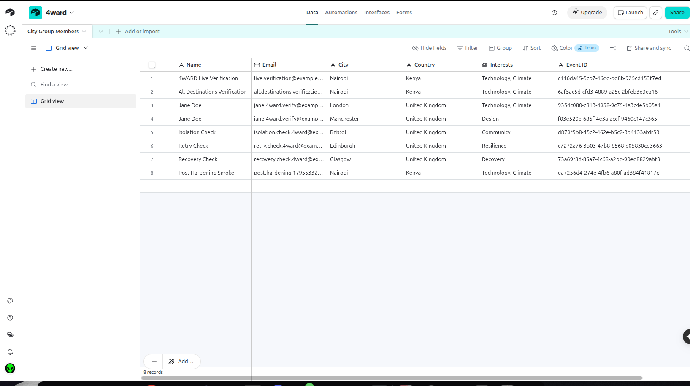
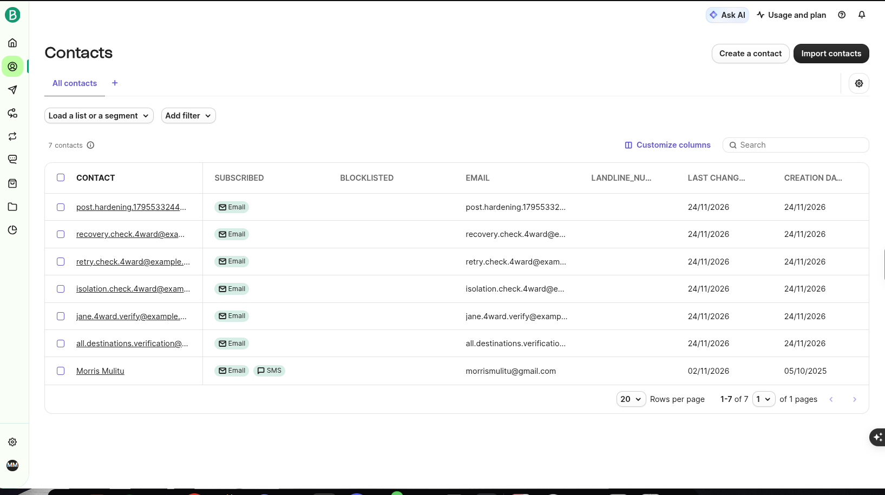
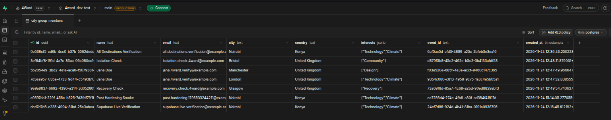

# Verification Evidence

This repository is verified with unit/behavioral tests and a live RabbitMQ integration suite.
External destination APIs are represented by local HTTP mocks in automated tests.

## Automated broker integration

Verified on 2026-11-24 with `pnpm test:integration` against the RabbitMQ
`4.4.1-management-alpine` container from `docker-compose.yml`.

The integration suite verifies:

1. A real Fastify request publishes one event through a durable topic exchange into three
   independent destination queues.
2. Airtable, Brevo, and Supabase HTTP adapters receive transformed records from local mock servers.
3. A failed Airtable lookup is retried while Brevo and Supabase continue independently.
4. Retry exhaustion reaches a durable destination DLQ.
5. Mandatory publishing rejects an event when no destination queue is bound.
6. A consumer shutdown deadline stops waiting without acknowledging an in-flight delivery; closing
   the channel causes RabbitMQ to requeue it.
7. Consumer shutdown otherwise drains in-flight work before closing the channel.
8. Concurrent producer publications with the same event ID use unique AMQP message IDs and do not
   interfere when one is returned.
9. Concurrent consumer confirmations use unique per-attempt IDs, and returned or negatively
   confirmed publications reject without acknowledging the original delivery.

Each integration test uses unique durable resources and removes them during teardown. A post-run
management API check confirms zero remaining test queues and exchanges.

## Current hardening verification scope

The automated suite does not claim live external API verification. Automated tests never contact
Airtable, Brevo, or Supabase. A separate post-hardening manual smoke registration is documented
below. Live credentials remain only in the ignored local `.env`.

## Pre-hardening live external verification

The following records were captured before the hardening pass and are retained as historical
evidence. They are not results from the current mocked/local automated suite.

### Happy path: verified pre-hardening

A synthetic Jane Doe submission for London, United Kingdom, with Technology and Climate interests
returned HTTP `202` for event
`9354c080-c813-4958-9c75-1a3c4e5b05a1`:

- Airtable record `rechM1eplVuoWoZQQ` matched the submitted fields and event ID.
- Brevo contact `3` matched `NAME`, `CITY`, and `COUNTRY`.
- Supabase row `7d3ea957-035a-4733-9d44-c5493b106a21` matched the event ID and stored JSONB
  interests.

### Existing-contact update: verified pre-hardening

Event `f03e520e-685f-4e3a-accf-9460c147c365` reused the same email and updated Brevo contact `3`
with HTTP `204`. It created Airtable record `rechGEX3MMwuGb5UW` and Supabase row
`5b2054e9-3bd2-4e1e-aca6-f507938149f1`.

### Failure isolation: verified pre-hardening

With Brevo stopped, event `d879f5b8-45c2-462e-b5c2-3b4133afdf53` created Airtable record
`recXZtI2dZzh3LiS6` and Supabase row `3ef64bf8-191d-4a7c-83aa-96c080cc1073`. RabbitMQ held one
message in the Brevo queue with zero consumers; restarting Brevo drained it and created contact
`4` for the synthetic isolation email with `CITY = Bristol`.

### Retry exhaustion and recovery: verified pre-hardening

With a temporary test-local Supabase URL override, event
`c7272a76-3b03-47b8-8568-e05830cd3663` retried at 1000 ms, 2000 ms, and 2000 ms before its fourth
attempt dead-lettered to `city-group.events.supabase.dlq` with `x-retry-count: 3`. Airtable
record `recUukkLoBPrOzVaZ` and Brevo contact `5` succeeded independently. Restored Supabase
configuration processed event `73a69f8d-85a7-4c68-a2bd-90ed8829abf3` into row
`9e9e8837-6692-4396-a314-3d052809aeb5`.

### Graceful shutdown: verified pre-hardening

Sanitized `SIGINT` records were captured for the producer and all three consumers before shutdown
deadline hardening.

```text
{"service":"airtable-consumer","signal":"SIGINT","msg":"Shutting down consumer"}
{"service":"brevo-consumer","signal":"SIGINT","msg":"Shutting down consumer"}
{"service":"supabase-consumer","signal":"SIGINT","msg":"Shutting down consumer"}
{"service":"producer","signal":"SIGINT","msg":"Shutting down producer"}
```

## Post-Hardening Live Smoke Test

Executed on 2026-11-24 at 18:14 EAT, after the final hardening changes and after the complete
offline verification gate passed.

- Producer health: HTTP `200`
- Registration: HTTP `202`
- Event ID: `ea7256d4-274e-4fb6-a80f-ad384f41817d`
- Airtable record: `rec5hlokOC0D9lXm2`
- Brevo contact: `7`
- Supabase row: `a9597da1-229f-456c-b525-7d3fdf71f1f7`

Each destination was independently queried through its API. The event ID and synthetic
registration fields matched in Airtable, Brevo, and Supabase.

The producer, Airtable consumer, Brevo consumer, and Supabase consumer each logged their `SIGINT`
shutdown sequence and exited within the configured deadline. No unhandled rejection or forced
termination was observed. RabbitMQ was then stopped with `docker compose down`.

No destination failure or deviation occurred.

### Sanitized dashboard screenshots

The supplied screenshots are included unmodified:



[Airtable record link](https://airtable.com/appXO7nJouokpVZtj/tblZmGNViEwOVs00y/viwytdx7QG2wZG56S/rec5hlokOC0D9lXm2)





## Final repository checks

Verified on 2026-11-24 after the hardening pass:

```text
pnpm build             -> exit 0
pnpm typecheck         -> exit 0
pnpm lint              -> exit 0
pnpm format:check      -> All matched files use Prettier code style
pnpm test              -> 11 files passed, 78 tests passed
pnpm test:integration  -> 1 file passed, 5 tests passed
docker compose config  -> exit 0
pnpm audit --prod      -> No known vulnerabilities found
```

Compose configuration resolves RabbitMQ host bindings to `127.0.0.1` for both ports. The
post-integration RabbitMQ management check reported zero remaining test queues and zero remaining
test exchanges.
